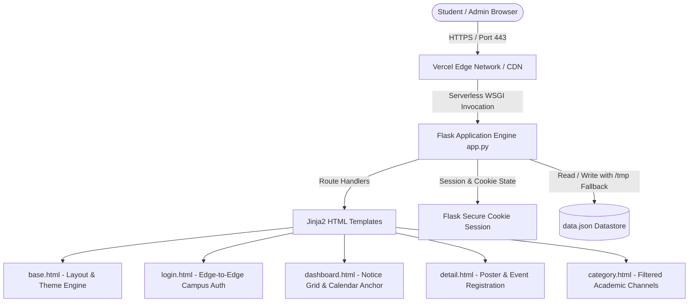

# Technical Requirements Document (TRD)

## Project Title
**InfoHub — Technical Architecture and Implementation Specification**

---

## 1. System Overview & Technology Stack

InfoHub is engineered with a lightweight, high-performance web architecture adhering to modern serverless deployment patterns:

| Layer | Technology | Version / Specification | Rationale |
| :--- | :--- | :--- | :--- |
| **Backend Framework** | Python Flask | `>=3.0.0` | Minimalist WSGI framework providing fast routing, session management, and template rendering without overhead. |
| **Frontend Styling** | Bootstrap 5 + Custom CSS | `5.3.x` | Responsive grid combined with bespoke glassmorphic cyber styling and CSS custom properties. |
| **Icons & Assets** | Bootstrap Icons | `v1.11.x` | CDN-delivered vector icons for academic categories, actions, and badges. |
| **Client Storage** | LocalStorage API | HTML5 Web Storage | Client-side credential persistence ("Remember Me") and active semester preferences. |
| **Data Persistence** | Atomic JSON Engine | Schema v2.0 (`data.json`) | Zero-maintenance datastore; automatically adapts to serverless `/tmp` in read-only runtimes (Vercel). |
| **Document Processing**| PyMuPDF / Fitz & Pillow | PyMuPDF `1.24+`, Pillow `10.0+` | High-fidelity PDF rendering and multi-page PNG asset extraction for academic calendars. |
| **Cloud Deployment** | Vercel Serverless | `@vercel/python` Builder | Global edge routing, automatic SSL, zero-cold-start optimization, and continuous git deployments. |

---

## 2. System Architecture



---

## 3. Data Model (`data.json`)

The platform utilizes a structured schema with three primary collections: `categories`, `notices`, and `users`.

### 3.1. Entity Relationship & Schema Definition

```json
{
  "categories": [
    {
      "id": "seminars",
      "name": "Seminars",
      "icon": "👨🏫",
      "tagline": "Technical research colloquiums, keynote lectures, and faculty symposia"
    },
    {
      "id": "hackathons",
      "name": "Hackathons",
      "icon": "💻",
      "tagline": "36-hour sprint coding, embedded systems prototyping, and buildathons"
    }
  ],
  "notices": [
    {
      "id": "SEM-2026-03",
      "category": "seminars",
      "title": "IDS & CareerXel – Emerging Technology Workshop Series 2026",
      "description": "Comprehensive online emerging technology workshop series focusing on AI, Cybersecurity, Blockchain...",
      "eligibility": "Open to all enrolled students across all branches and academic years.",
      "starting_date": "2026-10-26",
      "ending_date": "2026-10-30",
      "concerned_authorities": "Dept of CSE / CareerXel Cell",
      "verification_level": "official",
      "verification_label": "🟢 Officially Authorized by Faculty / Dean / HOD",
      "submission_type": "Online Track",
      "required_documents": [
        "GNIOT Student ID Card",
        "Laptop with Python installed"
      ],
      "official_url": "https://forms.gle/sample-ids-workshop",
      "poster_image": "static/ids_workshop_poster.png"
    }
  ],
  "users": [
    {
      "username": "student",
      "password": "password",
      "role": "student",
      "full_name": "Student Scholar",
      "department": "B.Tech Engineering",
      "semester": "8th Semester"
    },
    {
      "username": "admin",
      "password": "adminpassword",
      "role": "admin",
      "full_name": "Faculty Administrator",
      "department": "Central Administrative Tower",
      "semester": "Faculty / Academic Office"
    }
  ]
}
```

---

## 4. Application Routes & API Specifications

| Method | Route Path | Access Level | Description |
| :--- | :--- | :--- | :--- |
| `GET`, `POST` | `/login` | Public | Authenticates user credentials, sets session cookies, and handles Remember Me. |
| `POST` | `/register` | Public | Enrolls new student profiles into `data.json["users"]` and auto-authenticates. |
| `GET` | `/logout` | Authenticated | Clears server-side session and redirects to `/login`. |
| `GET` | `/` | `@login_required` | Main student dashboard: statistics, search/filter bar, notice grid, and Academic Calendar anchor. |
| `GET` | `/category/<category_id>` | `@login_required` | Displays notices filtered by specific academic department track. |
| `GET` | `/notice/<int:notice_id>` | `@login_required` | Detailed notice view with poster display, countdown, and direct action link. |
| `GET`, `POST` | `/admin/create` | `@admin_required` | Administrative notice composition form with priority tag and URL attachment. |
| `POST` | `/admin/delete/<int:notice_id>` | `@admin_required` | Removes notice record from `data.json` atomically. |
| `GET` | `/academic-calendar` | `@login_required` | Viewport for official GNIOT Odd Semester 2026-27 Academic Calendar PDF & PNGs. |

---

## 5. Security Architecture & RBAC Implementation

1. **Session Protection**: Flask signed cookies using cryptographic hashing (`app.secret_key`).
2. **Decorator-based Access Guards**:
   ```python
   def login_required(f):
       @wraps(f)
       def decorated_function(*args, **kwargs):
           if not session.get("logged_in"):
               flash("Authorization Required: Please authenticate with GNIOT Hub credentials.", "warning")
               return redirect(url_for("login"))
           return f(*args, **kwargs)
       return decorated_function

   def admin_required(f):
       @wraps(f)
       def decorated_function(*args, **kwargs):
           if not session.get("logged_in") or session.get("role") != "admin":
               abort(403)
           return f(*args, **kwargs)
       return decorated_function
   ```
3. **Role Segregation**: Students possess read & engage permissions; Administrators hold full CRUD permissions over notices.

---

## 6. Vercel Serverless Configuration & Optimization

### 6.1. `vercel.json` Specification
```json
{
  "version": 2,
  "builds": [
    {
      "src": "app.py",
      "use": "@vercel/python"
    }
  ],
  "routes": [
    {
      "src": "/(.*)",
      "dest": "app.py"
    }
  ]
}
```

### 6.2. Serverless Read-Only File Handling
On Vercel, the root filesystem is read-only. `app.py` detects serverless deployment via `os.environ.get("VERCEL")` and dynamically copies `data.json` to `/tmp/data.json` to allow in-memory/temporary state mutations without raising `OSError: [Errno 30] Read-only file system`.

---

## 7. Deployment & Verification Pipeline

```bash
# 1. Initialize and Stage Workspace
git init
git add .
git commit -m "feat: complete InfoHub portal with academic calendar & serverless deployment"
git branch -M main

# 2. Remote Synchronization
git remote add origin https://github.com/suhaniisrivastava28/InfoHub---Digital-InfoHub-for-centralized-campus-information-and-student-engagement.git
git push -u origin main --force

# 3. Production Deployment via Vercel CLI
vercel --prod --yes
```
